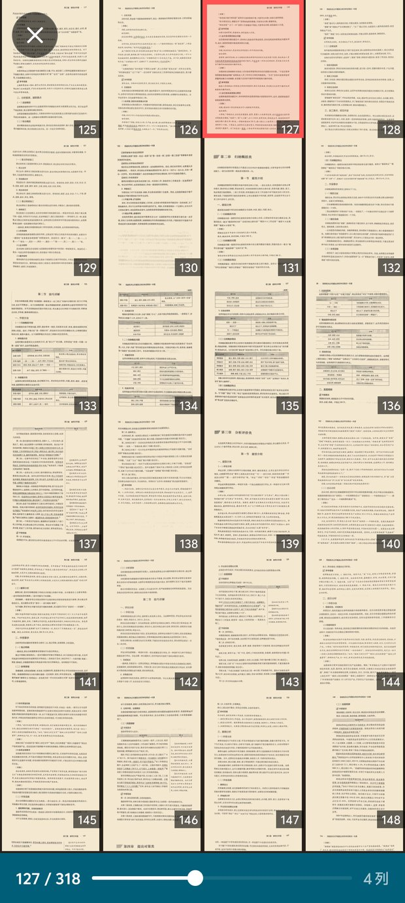
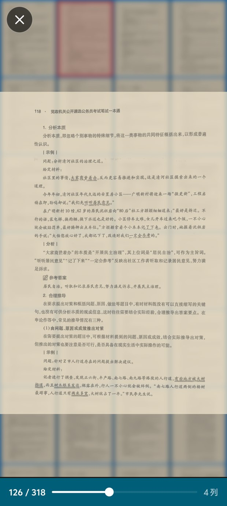
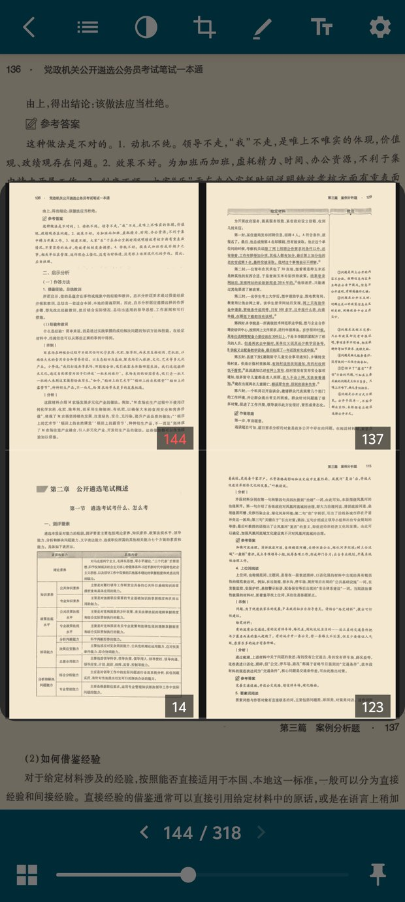
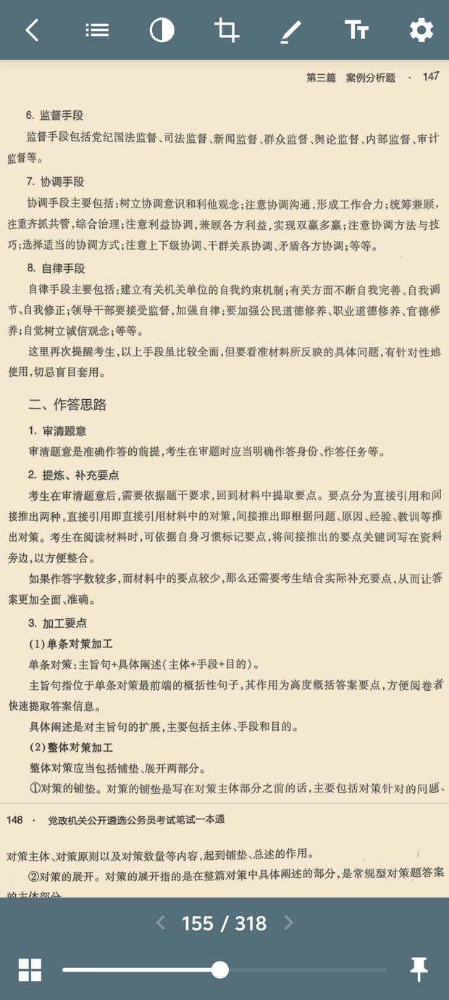
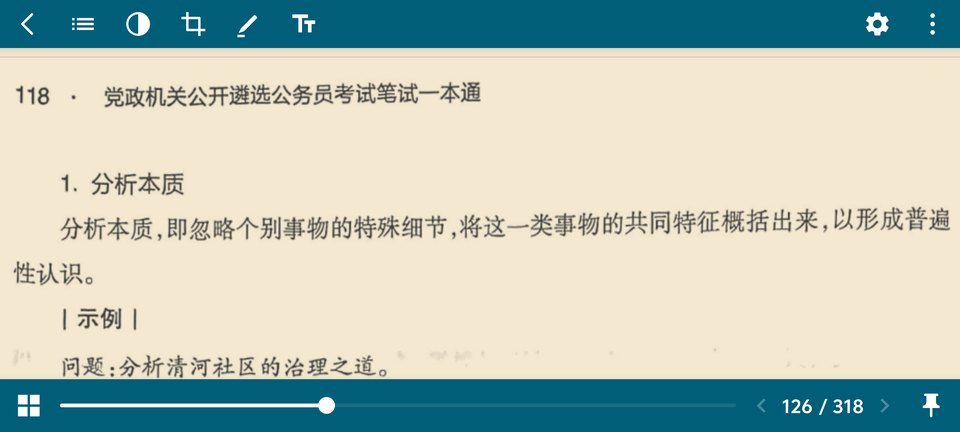
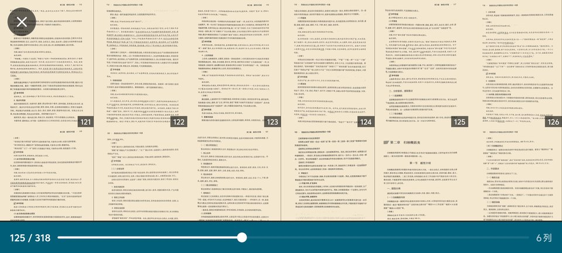
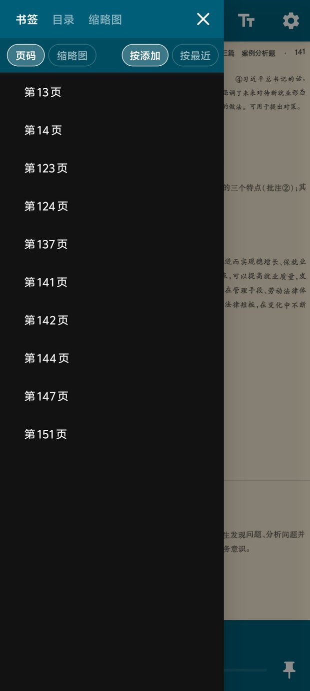
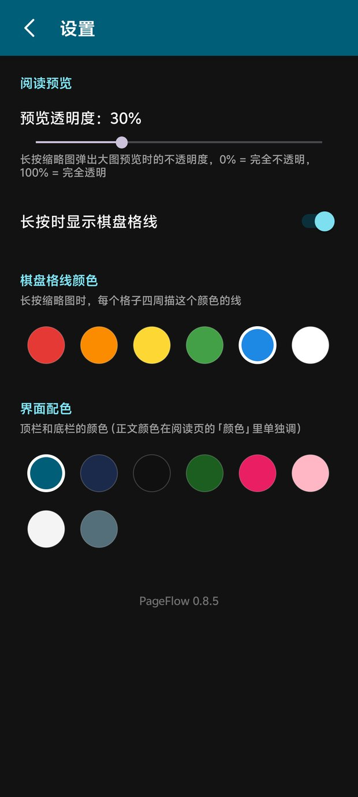

# PageHop

**把扫描版 PDF 读成一本"能翻的书"。**

手机上看扫描件最烦的三件事：白边吃掉半屏、字灰得像没对上焦、翻到一半忘了自己在哪。PageHop 只做 PDF、只做阅读，把这三件事各拆开解决一遍。

名字里的 *hop* 就是核心动作：翻开缩略图地图看一眼，一点就落到想去的那一页，再一点跳回来——像在页与页之间轻跳，而不是一页页硬翻。

[📥 下载最新版 APK](PageHop-latest.apk) ｜ [设计文档](DESIGN.md) ｜ [反馈问题](https://github.com/Speacnow/page-hop/issues)

---

## 用了就回不去的四个动作

### 一、缩略图就是全书地图

点右下角九宫格，整本书变成一屏格子：**哪一页有表格、哪一章快结束，一眼看到**。

- 双指捏合改列数（2–10 列）：粗看用 3 列，找具体某一页就用 6 列
- 当前页描红框；拖底栏进度条时，地图跟着滚
- 格子之间没有缝隙，一屏就是一整张"书"

#### 长按一格：不离开地图，也能看清这一页

**长按任意一格**（手机轻震一下），整页就以原始清晰度浮在网格上方：

- 网格连同红色棋盘格一起变模糊、滚动被锁住；**大图按屏幕宽度 1:1 渲染**，不是把缩略图拉大，字是真的能看清
- 手指还在格子上继续滑 → 预览跟着换页；**松手后地图原地不动**，只把最后看过的那页描红，你可以接着往下挑
- 半透明浮层，透明度在设置里 0%–100% 可调——调低一点，还能看见底下格子的位置
- 长按期间网格上的页码角标自动隐藏，视线不会被打断

### 二、跳来跳去，也不怕迷路

翻参考书就是这样：看第 137 页的解析，跳回第 14 页的原文，再回来。

- **只有"有意图的跳转"才记账**：输页码、点目录、点书签、点缩略图、拖完进度条松手，并且在那页**停留满 1 秒**
- 底栏左右两个箭头：**后退**回到这次跳转的来源页，**前进**撤销后退；没得退 / 进时自动置灰
- **长按任一箭头**，弹出最近 6 个跳转点的整页缩略图，点哪张就去哪张
- 随手往下翻、快速扫一遍，都不会污染这条历史

### 三、先把扫描件变好看

- **自动裁边**：逐页检测正文范围，裁掉四周白边。留白默认 2%，可在 0–10% 之间调
- **7 种颜色模式**：正常 / 夜间 / 夜间柔和 / 灰度 / **护眼米黄** / 棕褐对比 / 高对比
  - 护眼米黄是米黄纸 `#F4E8D0` 配暖灰墨 `#2D2D2D`，对比度约 5:1——不是那种"说是黄的、看着还是白的"
  - 夜间柔和把纯黑底压成深灰，长时间看不刺眼
- 颜色是**绘制时**加的滤镜，切换不重新解码，318 页的书也是立刻统一

  

### 四、横屏：不是把竖屏拉宽

横过来读扫描件，一屏能放下的正文几乎翻倍，翻动次数自然就少了。但直接把竖屏布局拉宽，结果是上下两条大黑边、一半屏幕被工具栏吃掉。

针对横屏单独做了一套：

- 顶栏从 48dp 压到 **40dp**，**底栏两行并成一行**：`缩略图 · 进度条 · ‹ 126 / 318 › · 旋转`——正文可视高度多出约 14%
- **转屏不重建界面**：Activity 不重启，阅读位置、缩放倍率、批注、面板状态全部原地保留，不会跳回第一页
- 横屏 + 批注：手指照常写字，**从左右边缘起手上下滑就是翻页**（横屏两侧本来就是页边距，够宽好按）
- 缩略图地图按新宽度重算列数：6 列、12 张一拍，一屏能扫过大半本书

---

## 功能一览

| | |
|---|---|
| **目录 / 书签** | 左侧面板：**书签 / 目录 / 缩略图** 三个页签，打开时默认先看自己的书签。书签页签顶部有一条常驻选项：`页码 / 缩略图` 换画法、`按添加 / 按最近` 换顺序，列表怎么滚它都不动 |
| **手写批注** | 顶栏「笔」直接开关（开启时变红），手指即笔。**单指写字、双指上下滑翻页**；也可以**从屏幕左右边缘起手**上下滑——只滚页、不落笔 |
| **音量键翻页** | 设置里可开（**默认关闭**）：音量上 = 上一页，音量下 = 下一页。开着时音量键不再调音量；目录 / 缩略图面板打开时不接管 |
| **框选高亮** | 长按页面拖动框选，四种颜色 |
| **文字批注** | 点页面任意位置打字，随时改文字 / 颜色 / 字号 |
| **导出批注** | 把高亮、手写、文字批注烧进每一页，另存为新 PDF，源文件不动 |
| **全屏阅读** | 单击页面收起上下栏，正文铺到屏幕物理边缘 |
| **配色** | 顶栏 / 底栏 8 种配色（深青 / 深蓝 / 黑 / 墨绿 / 粉 / 樱花粉 / 白 / 灰），图标颜色按背景亮度自动取深或浅 |
| **设置页** | 独立整页：预览透明度、棋盘格线开关与颜色、音量键翻页、界面配色。改完返回立刻生效 |
| **续读** | 退出再进直接停在原页码；每本书的页码、颜色、裁边、批注全部记住 |

  
  

左：目录面板（书签 / 目录 / 缩略图，选项条常驻）　右：设置页（透明度、音量键翻页、配色）

---

## 安装

1. 下载 [PageHop-latest.apk](PageHop-latest.apk)
2. 手机上点开安装；第一次会提示"允许安装未知来源应用"，放行即可
3. iQOO / vivo 如果弹出「安全守护」，选继续安装

覆盖安装不用卸载：签名相同，**阅读进度和批注都会保留**。

要求 Android 8.0（API 26）以上，已在 Android 15 / OriginOS 5 上实测。

---

## 已知限制

- 扫描版 PDF 没有文字层，所以**不能选字、不能全文搜索**（要做得上 OCR，见 Roadmap）
- 「目录」页签只读 PDF 自带的大纲；没有大纲的 PDF 需要自己加书签
- 一次只处理一本书，没有书库管理——够用，也够简单

## Roadmap

- 左右翻页（现在是竖向连续滚动）
- OCR 文字层：选字、全文搜索、复制

---

## 开发者

构建方式、真机无线调试、模块划分，以及每个"为什么这么写"的来龙去脉，都在 [DESIGN.md](DESIGN.md)。
